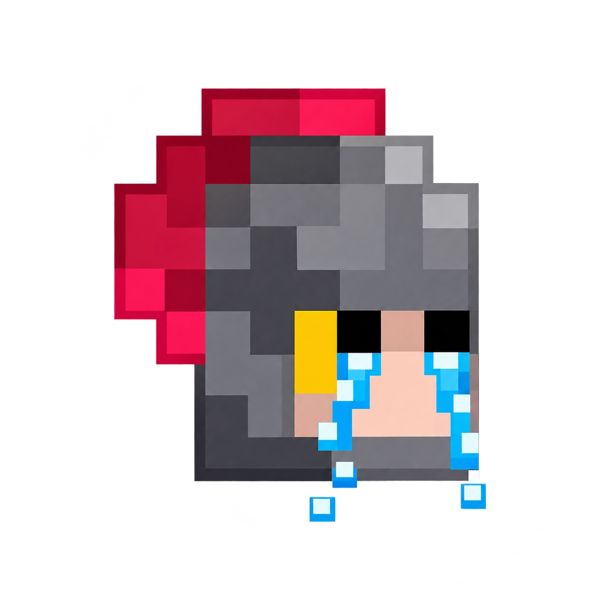

<!-- markdownlint-disable MD033 MD041 -->

# ok-RwtD

_✨ Rogue with the Dead visual automation — design every decision in your workflow ✨_

English | [繁體中文](README.md)

  
  
  
  
  

## Overview

**ok-RwtD** is an unofficial visual automation tool for *Rogue with the Dead*, built on [OK-Script](https://github.com/ok-oldking/ok-script). It combines a browser-based Dashboard, reusable action modules, visual decision workflows, and a Farm scheduler so you can build and manage your own automation instead of relying only on fixed scripts.

> Configure recognition, decisions, actions, and failure recovery through visual workflows.

## ✨ Features

### 🧠 Visual Decisions

Connect decision nodes on a Canvas and evaluate **image templates, OCR text and numbers, colors, and shared variables**.

- Combine conditions with **AND / OR**.
- Use **Guards** to control whether nodes may execute and **target conditions** to choose detected action positions.
- Handle **YES / NO / UNKNOWN** separately so an unreadable observation is not mistaken for a confirmed negative.

### 🧩 Custom Modules

Create reusable modules with **taps, long presses, swipes, text input, and recognition-based actions**.

- Configure target selection, timing, repetition, and optional Step conditions.
- Locate targets with templates, OCR, colors, or combined conditions.
- Use **ROI TAGs** to share search regions across Steps.
- PADDING supports multiple OCR and COCO filters in the same B region, such as exploration below 100% and no `no_gem` marker.

### 🗺️ Custom Canvases

- Connect modules and decision nodes into **Chains**.
- Create branches, attach Guards, and include notification nodes.
- Maintain separate Canvases for different stages or activities while reusing modules.
- Edit nodes, copy and paste, and arrange workflow layouts visually.

### 🔄 Farm Scheduler

- Execute configured Chains in order, following their policies; a **Farm round** is one pass through the scheduled workflow, not a single tap.
- Use **Background Triggers** to monitor conditions and queue actions.
- Eligible preemptive Triggers can let the current gesture finish, cancel remaining node actions, then take over.
- Use zero-interval Triggers as recovery **Solvers**.
- Configure scheduled activities, retry and execution limits, cooldowns, and round-based Guards.

### 📊 Dashboard & Diagnostics

- Edit workflows, preview recognition, adjust ROIs, and inspect pairing results and execution status.
- Review logs and failure reports to investigate skipped actions, recognition issues, and exhausted retries.
- Display OCR and template search regions on failure screenshots.
- Optionally configure **Discord notifications** for execution and failure updates.

The **Web profile uses the local OK backend** as a **Dashboard Task / WebView entry point**, not a separately hosted Dashboard website. Some editing features can work offline; device automation and connected integrations depend on their specific requirements.

## 📱 Android Setup

1. Open **Settings → About phone → Software information** and tap **Build number** seven times to enable Developer options. Menu names vary by device.
2. Enable **USB debugging** in Developer options.
3. Connect the Android device to your Windows PC using a **USB data cable**.
4. Unlock the phone and accept **Allow USB debugging?** Only remember authorization on a trusted computer.
5. Launch **ok-RwtD** and select the Android device.

If your device is not detected, check the cable, USB connection mode, debugging authorization, and manufacturer's Windows USB driver.

## 💻 Requirements

- **Windows**; application configuration targets **Python 3.12** (full packages include their local runtime).
- Android device with USB debugging and a data-capable USB cable.
- Game UI changes, resolution differences, or outdated templates may affect recognition.

## 📥 Downloads

👉 **[Latest Update](https://github.com/GammaHH/ok-RwtD/releases/latest)**

> The latest release may contain only application updates. For a first installation, choose an installer from [v1.0.0](https://github.com/GammaHH/ok-RwtD/releases/tag/v1.0.0), then update from the launcher.

| Edition | Description |
|---|---|
| **Global Setup** | Full installer with native Qt desktop interface; recommended starting point. |
| **Global Portable ZIP** | Full portable package including local runtime; extract and launch. |
| **Online Setup** | Lightweight installer downloading application and runtime during initial setup. |
| **ZIP** | Portable online launcher; initial setup requires internet. |
| **Web Setup — Experimental** | Full installer with WebView / Dashboard Task entry point; startup and Task compatibility remain unverified. |
| **Web Portable ZIP — Experimental** | Full portable package with WebView / Dashboard Task entry point; startup and Task compatibility remain unverified. |

Offline packages include a local runtime; **updates, Discord, and other connected features still require internet access**.

## Canvas Downloads

- [亡途第一關V2.6.5](https://raw.githubusercontent.com/GammaHH/ok-RwtD/main/assets/rwtd/scheduler/decision.json)
- [亡途第三關V1.6.2](https://raw.githubusercontent.com/GammaHH/ok-RwtD/main/assets/rwtd/scheduler/canvases/Canvas_2c79ed548e63429194ce162529ba92ca.json)
  - [Repeat Expedition module JSON](https://raw.githubusercontent.com/GammaHH/ok-RwtD/main/assets/rwtd/modules/user/expedition_again.json)
- [亡途第四關V1.6.9](https://raw.githubusercontent.com/GammaHH/ok-RwtD/main/assets/rwtd/scheduler/canvases/Canvas_88e97997de90421fa51b14a6e9a657f2.json)
- [亡途第二關V1.6.4](https://raw.githubusercontent.com/GammaHH/ok-RwtD/main/assets/rwtd/scheduler/canvases/Canvas_641e5cc1189d4b19979097aeae75b319.json)
- [亡途第五關V1.8](https://raw.githubusercontent.com/GammaHH/ok-RwtD/main/assets/rwtd/scheduler/canvases/Canvas_d931bc96c5004aff9ef660852ef3192b.json)
- [亡途迷宮活動V1.4.1](https://raw.githubusercontent.com/GammaHH/ok-RwtD/main/assets/rwtd/scheduler/canvases/Canvas_9ac946b9d0ff4008b4e429dfea321837.json)
- [亡途牢獄活動V1.1.8](https://raw.githubusercontent.com/GammaHH/ok-RwtD/main/assets/rwtd/scheduler/canvases/Canvas_5308107fb0c94db781d9ccfd82ae5f99.json)
- [亡途常夜之國V1.2.1](https://raw.githubusercontent.com/GammaHH/ok-RwtD/main/assets/rwtd/scheduler/canvases/Canvas_b334b301300e4678915fbf89a1d78ef7.json)

These are the current public templates. Save a JSON file, select or create a Canvas in the Dashboard, import it as a Canvas draft, and review its module references before saving.

## Local Data and Updates

Supported installed builds store Canvas files, modules, and the Farm SQLite database in `%LOCALAPPDATA%\RwtDUserData\<installation ID>`. Before upgrading to the first build with persistent storage, close OK and back up `working\assets\rwtd` outside the installation. The launcher may sync the old working tree before migration can run.

## ☕ Support

If this project helps you, you can support development voluntarily ☕

Public features and Releases remain free; contributions are optional.

## 🛠️ Built With

- [OK-Script](https://github.com/ok-oldking/ok-script)
- [OK-Script App](https://github.com/ok-oldking/ok-script-app)
- [PyAppify](https://github.com/ok-oldking/pyappify)
- [OnnxOCR](https://github.com/ok-oldking/OnnxOCR)
- [PyQt-Fluent-Widgets](https://github.com/zhiyiYo/PyQt-Fluent-Widgets)

The public repository includes runtime files and third-party license notices (`vendor-licenses`). Full development documentation and tests are maintained in the private DEV repository. Thanks to the upstream maintainers and open-source community.

## ⚠️ Disclaimer

**ok-RwtD is an unofficial community project** and is not affiliated with the developers or publishers of *Rogue with the Dead*. Users are responsible for checking the game's terms and accepting the risks of automation.

---

**Keywords:** Rogue with the Dead, ok-RwtD, automation, Canvas, visual workflow, decision nodes, OCR, template matching, Farm scheduler, Android, USB debugging, Dashboard, OK-Script, Python, Windows
